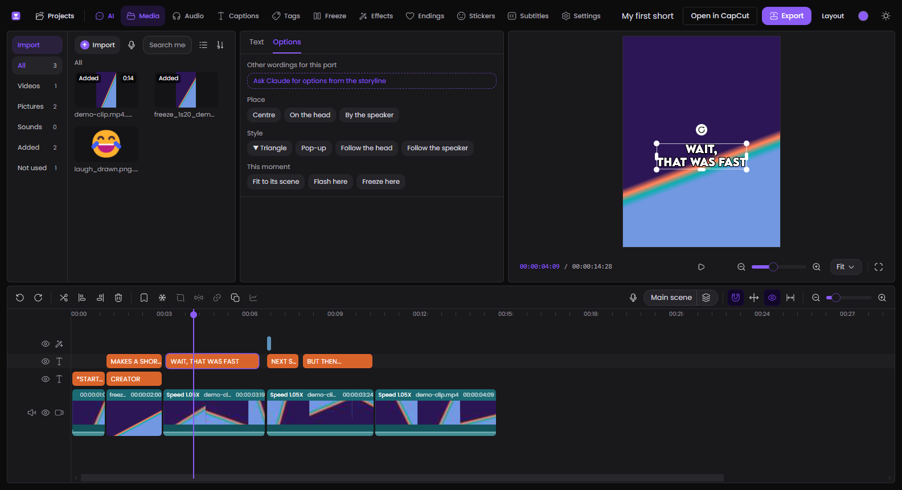
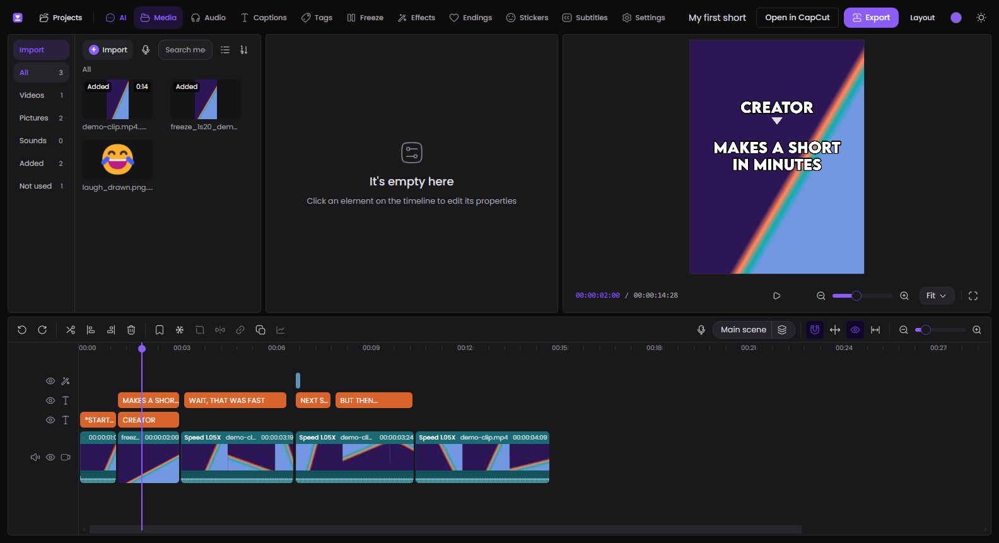
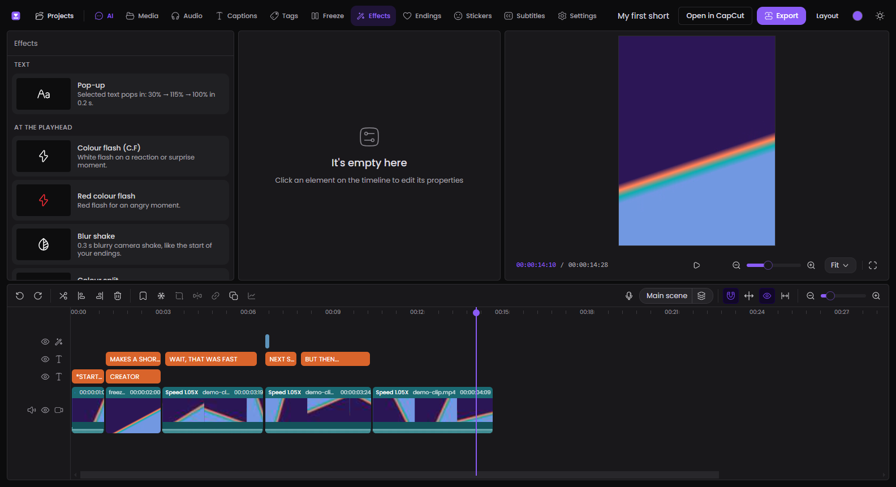
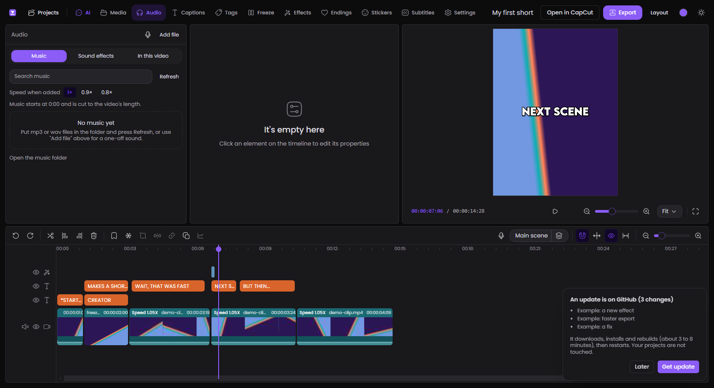

<div align="center">

# 🎬 JEO Editor

**A desktop video editor for text-commentary Shorts, with Claude built in.**

Silent footage, ALL-CAPS captions, ▼ tags on heads, freeze frames, a 😂 ending,
and a video that always ends on a `:29` frame. It looks and works like CapCut,
is built around one editing style, and hands off to CapCut when you want it to.

-8b5cf6?style=for-the-badge)


-ff7a1a?style=for-the-badge)



</div>

---

## 📑 Contents

1. [What this is](#-what-this-is)
2. [Before you install: read this](#%EF%B8%8F-before-you-install-read-this)
3. [Install it, step by step](#-install-it-step-by-step)
4. [Send the report](#-send-the-report)
5. [Your first video in 5 minutes](#-your-first-video-in-5-minutes)
6. [Everything it can do](#-everything-it-can-do)
7. [The AI tab (Claude)](#-the-ai-tab-claude)
8. [Working with CapCut](#-working-with-capcut)
9. [Getting updates](#-getting-updates)
10. [Two people testing together](#-two-people-testing-together)
11. [Where your things are kept](#-where-your-things-are-kept)
12. [If something goes wrong](#-if-something-goes-wrong)
13. [Removing it](#-removing-it)
14. [For developers](#-for-developers)
15. [Credits and licence](#-credits-and-licence)

---

## 🎯 What this is

JEO Editor is a video editor that runs on your own computer. It is made for one
kind of video: short vertical clips (1080 × 1440, 30 fps) told with on-screen
text instead of a voice-over.

| You want to… | JEO Editor does it with… |
|---|---|
| Cut a clip, speed parts up, re-frame each shot | A CapCut-style timeline |
| Add captions in the house style | One click: LEMON MILK Bold, white, dark outline, centred |
| Label a person | A ▼ tag that sits on their head and can follow them |
| Hold a moment | A 2-second freeze frame at the playhead |
| Finish the video | A one-click 😂 or ❤️ ending, then "End on :29" |
| Let AI do the first pass | Tell Claude the storyline; it builds the edit |
| Polish in CapCut | "Open in CapCut" writes a real CapCut project |

It is a personal tool, not a store product. Expect rough edges, and please
report them (see [Send the report](#-send-the-report)).

---

## ⚠️ Before you install: read this

> [!WARNING]
> Setup downloads about **1.7 GB** and uses about **2.5 GB** of disk space.
> It needs an internet connection and takes **10 to 30 minutes**.

> [!IMPORTANT]
> This is for **64-bit Windows 10 or 11**. It has not been tried on Mac or Linux.

### What you need first

| Thing | Why | How to get it |
|---|---|---|
| **Windows 10 or 11, 64-bit** | The setup script and the window program are for Windows | — |
| **4 GB free disk** (more is better) | Code packages 1.6 GB, window program 270 MB, the build 400 MB | — |
| **8 GB memory or more** | Video editing in a browser engine is heavy | — |
| **[Git](https://git-scm.com/download/win)** 2.30+ | Downloads the editor and its updates | `winget install --id Git.Git -e` |
| **[Node.js](https://nodejs.org)** 20+ | Runs the editor's local server | `winget install --id OpenJS.NodeJS.LTS -e` |
| **[Bun](https://bun.sh)** 1.2+ | Installs the code packages and builds the editor | `winget install --id Oven-sh.Bun -e` |

If Git, Node.js or Bun is missing, the setup script tells you and offers to
install it with Windows' own installer (`winget`). It asks first.

### What setup puts on your computer

| # | What | Size | Where it goes |
|---|---|---|---|
| 1 | The editor's code packages (open-source JavaScript libraries) | ~1.6 GB | `node_modules` inside this folder |
| 2 | **Electron 33.2.0**, the program that shows the editor in a window | ~110 MB download, 270 MB on disk | `apps\jeo-desktop\runtime` inside this folder |
| 3 | The built editor | ~400 MB | `apps\web\.next` inside this folder |
| 4 | A small settings file | 1 KB | `apps\web\.env.local` |
| 5 | Your data folders (empty at first) | — | `data` inside this folder |
| 6 | A **JEO Editor** shortcut | 2 KB | Your Desktop |

Electron is downloaded from Electron's own GitHub releases page, and the
download is checked against the fingerprint Electron publishes before it is
unpacked.

### Optional extras (setup asks; you can say no)

| Extra | What you lose without it | Size |
|---|---|---|
| **Python 3** with `opencv-python` and `numpy` | "Follow the head", "Follow the speaker", and the CapCut import/export | ~80 MB |
| **[Claude Code](https://claude.com/claude-code)** and a Claude plan | The **AI** tab. Everything else works without it | separate install |
| **CapCut** desktop | "Open in CapCut" and "Import from CapCut" | separate install |

### What it does **not** do

- It does **not** upload your videos or projects anywhere. Everything runs on
  `localhost` on your own PC.
- It does **not** need an account or a login.
- It does **not** change Windows settings, the registry or other programs.
  Apart from the Desktop shortcut (and anything you agree to install with
  `winget` or `pip`), everything stays inside this one folder.
- It does **not** send the report. You send that yourself.

### What reaches the internet, and when

| When | What | Why |
|---|---|---|
| During setup and updates | npm registry, GitHub | Downloading code packages, Electron and updates |
| Every 10 minutes while the editor is open | `git fetch` to this GitHub repo | To see if a newer version was pushed |
| Only if you use the AI tab | Anthropic, through Claude Code | Your messages, the edit's text, and frames of your video that Claude looks at |
| Only if you use Stickers or auto-subtitles | The sticker or speech provider built into OpenCut | Those features come from OpenCut as they are |

---

## 🚀 Install it, step by step

### Step 1 · Install Git

If you don't have Git, open **PowerShell** (Start menu → type `powershell`) and run:

```bash
winget install --id Git.Git -e
```

Close PowerShell and open it again afterwards.

### Step 2 · Download the editor

Pick a folder with space in it (for example `Documents`) and run the lines
below.

> ⚠️ **Keep the folder path short.** Windows refuses very long file paths, and
> the code packages nest deeply. `Documents\jeo-video-editor` or
> `C:\jeo-video-editor` is fine. A folder buried many levels deep is not; setup
> checks this and tells you.

```bash
cd $HOME\Documents
```

```bash
git clone https://github.com/izzylogo/jeo-video-editor.git
```

```bash
cd jeo-video-editor
```

### Step 3 · Run setup

Either double-click **`setup.cmd`** in the folder, or run:

```bash
.\setup.cmd
```

It explains what it is about to do and asks before it starts. Then:

| Step | What you see | How long |
|---|---|---|
| 1 | Checks Windows, disk space, Git, Node.js, Bun | seconds |
| 2 | Creates the settings file | instant |
| 3 | Installs the code packages | 5 to 20 min |
| 4 | Downloads and checks Electron | 1 to 5 min |
| 5 | Builds the editor | 2 to 6 min |
| 6 | Offers the optional Python packages | 1 min |
| 7 | Creates your data folders and the Desktop shortcut | instant |
| 8 | Starts a hidden test window and writes the report | about 1 min |

> [!TIP]
> If setup stops and says a program is missing, install it as it suggests,
> **open a new PowerShell window**, and run `.\setup.cmd` again. It is safe to
> run as many times as you like; finished steps are skipped or redone quickly.

### Step 4 · Start it

Double-click **JEO Editor** on your Desktop, or run:

```bash
.\start.cmd
```

The first start takes 10 to 20 seconds.

---

## 📨 Send the report

Setup writes two files in the editor's folder:

- **`JEO-REPORT.md`**: your computer (Windows, processor, memory, graphics),
  which tools are installed, each installation check, and the result of a real
  run test (open the editor, add a caption, add an effect, draw a frame, undo,
  save).
- **`JEO-REPORT.png`**: a picture of that test window.

**Please do this once after installing:**

1. Open `JEO-REPORT.md` in Notepad.
2. Answer the five short questions in part 6 ("In your own words").
3. Send both files to the person who shared the editor with you.

Your Windows user name is replaced by `<you>` in the report, and nothing is
sent automatically. To write a fresh report at any time:

```bash
.\report.cmd
```

---

## 🎞 Your first video in 5 minutes

1. Open JEO Editor. On the Projects page click **New project**.
2. Click **Media** → **Import** and choose a video. Drag it onto the timeline.
3. Play it with **Space**. Move the mouse over the timeline to preview any moment.
4. Put the playhead where a new scene starts and press **S** to cut.
5. Click **Captions** and pick a caption. Type your words in the box on the right.
6. Click **Tags**, add an identity tag, and drag it onto the person's head.
7. Put the playhead on the last cut, click **Endings** → **Funny ending**.
8. Click **End on :29**, then **Export**. The video lands in `data\output`.



---

## 🧰 Everything it can do

### ✂️ Editing

- **Timeline like CapCut's**: each clip shows its speed, name and length, a
  filmstrip of what is actually in that clip, and a sound band with the wave.
- **Toolbar**: undo, redo, split, delete left, delete right, delete, marker,
  freeze, crop, mirror, duplicate, record voice, snapping, main-track magnet,
  preview axis, fit, zoom.
- **Hover preview**: move the mouse over the timeline to see that moment,
  with a faint line under the mouse. The playhead stays where it is.
- **Speed** per clip, **framing** per shot (position and zoom), **mirror**, **crop box**.
- **Volume line**: drag the line on a clip's sound band up or down, in dB.
- **Several clips at once**: select more than one and change what they share
  (size, scale, position, style, volume) in one go.
- **Projects page**: open any project or start an empty one.

### 🔤 Text in the house style

- **Captions**: scene text (`*ACTION*`), narrative, quoted beat, dialogue,
  speaker name, twist line (`BUT THEN...`, `UNTIL...`).
- **Tags**: identity tag with ▼, feeling tag, arrow, spotlight.
- **Standard look**: LEMON MILK Bold, white, dark outline, font size 12 at
  scale 120% (the same numbers CapCut shows).
- **Text settings like CapCut's**: font size, bold / underline / italic, case,
  alignment, 14 preset styles, scale, position, rotate, opacity.
- **Quick options on any text**: centre, on the head, by the speaker, ▼,
  pop-up, follow the head, follow the speaker, fit to its scene, flash here,
  freeze here. Also on the right-click menu.
- **Follow the head / speaker**: the text tracks a moving person with
  position keyframes (needs the optional Python packages).
- **Snap texts to cuts**: no text starts before its scene.
- **Typing never lags**: the box keeps up with the keyboard and the preview
  catches up when you pause.

### ✨ Effects, transitions, endings



- **House effects**: pop-up (30% → 115% → 100% in 0.2 s), colour flash, red
  flash, blur shake, colour split.
- **Motion**: zoom punch, slow zoom in, shake, glitch, blur.
- **Looks**: black and white, old film, vivid, cold, darker, dark edges.
- **Transitions** on the nearest cut: dip to black, dip to white, glare, blur,
  zoom, shake.
- **Endings**: one-click 😂 or ❤️ ending (blur shake → emoji fades in and
  grows → colour split) and **End on :29** (trim or extend to the frame).
- **Freeze frame**: 2 seconds at the playhead, with an optional sound.

### 🔊 Sound

- **Audio tab**: Music and Sound effects from your `assets` folders, with
  search and listen-before-you-add. Music starts at 0:00 and is cut to the
  video; sound effects land on the playhead.
- **In this video**: every sound with its own volume, mute and remove, and
  one switch for all the clips' own sound.
- **Record voice** from the playhead, saved as WAV.

### 🖥 The window

- **Layouts**: JEO, CapCut style, CapCut tall preview, Big preview, Tall
  timeline, Preview on the left, Wide AI chat. Edges still drag.
- **Colours**: pick an accent and a base; every other colour follows. Light
  and dark themes.
- **Media panel like CapCut's**: kinds on the left, Import / Record / search
  on top, an "Added" badge on files already in the timeline.
- **Fits small screens**: icons-only category bar on small laptops, a single
  column at phone width.
- **Loading feedback** everywhere something takes time.
- **Saving**: every project is also a real folder on disk, restored
  automatically if the app's internal storage is ever cleared. Deleted
  projects go to a trash folder, not into thin air.

---

## 🤖 The AI tab (Claude)

The **AI** tab is a chat with Claude that can edit your timeline directly. Tell
it the storyline or paste a script; it looks at the footage, cuts it, writes
the captions and tags, adds the freeze, effects and ending, and ends on `:29`.
You can also select one text and ask for **other wordings**; they come back as
one-click choices.

> [!IMPORTANT]
> The AI tab needs **[Claude Code](https://claude.com/claude-code)** installed
> and signed in on your PC with **your own** Claude plan. JEO Editor does not
> include a Claude account or API key, and nothing about the author's account
> is in this download. Without Claude Code the AI tab tells you so, and every
> other part of the editor works normally.

What Claude can do through the editor (its tools): read the edit, look at
frames of the source or the timeline, build the cut, re-frame clips, add
freeze / text / effects / arrows / endings, offer text options, follow a head,
add music and sounds, undo, export.

**Live link**: if you use Claude Code in a terminal next to the editor, it can
drive the open window too, so an edit you ask for there appears straight away:

```bash
node apps\jeo-desktop\tools\jeo-live.cjs --status
```

---

## 🔁 Working with CapCut

| Button | What happens |
|---|---|
| **Open in CapCut** (top right) | Writes the timeline as a **new** CapCut project and tells you when CapCut is open. Existing CapCut projects are never changed. |
| **Import from CapCut** (Projects page) | Lists your CapCut projects; pick one and it becomes a new JEO project. CapCut's files are only read. |

**Carries across to CapCut**: cuts, speed, framing, mirror, clip volume,
freeze frames, texts (words, time, position, size, colour, outline, box, ▼),
pop-up / follow / growing-emoji keyframes, sounds, and three effects as
CapCut's own (colour split → *RGB Distort*, blur shake → *Shake*, glare →
*Glare II*).

> [!NOTE]
> CapCut can only use effects it has already downloaded. Those three are
> copied from **your own** CapCut projects, so they only carry across if you
> have used them in CapCut before. Anything left out is listed after the export.

**Comes in from CapCut**: cuts, speed, framing, mirror, volume, texts with
colour and outline, sounds, keyframes. CapCut's own effects, transitions,
stickers and text animations stay in CapCut, and the import says which.

Both need the optional Python and were checked against **CapCut 9.7**. A
CapCut update can change its project format and break them.

---

## 🔔 Getting updates

**Inside the editor.** While it is open, the editor looks at this GitHub repo
every 10 minutes. When a newer version has been pushed you get a card:



**Get update** downloads the changes, installs anything new, rebuilds (3 to 8
minutes, each step shown) and restarts on your project. Your projects are not
touched.

**From the folder.** The same thing with everything shown on screen. Close the
editor first:

```bash
.\update.cmd
```

**By email.** GitHub does not email you for ordinary pushes. If the author
publishes a *Release*, you can be emailed: on the repo page click **Watch** →
**Custom** → tick **Releases**.

> [!NOTE]
> Updates only work if you have **not** edited the editor's own code files. If
> you have, `update.cmd` tells you which files clash.

---

## 👥 Two people testing together

A simple loop for the author and a friend:

**The author (who changes the editor)**

```bash
git add -A
```

```bash
git commit -m "Say what changed in plain words"
```

```bash
git push
```

The commit messages are what the friend sees in the update card, so write them
for a person, not for a machine.

**The friend (who tests it)**

1. Within 10 minutes of the push, the open editor shows **An update is on
   GitHub**. Click **Get update**. (Or run `.\update.cmd`.)
2. Try the new thing.
3. Run `.\report.cmd`, answer the questions in part 6, and send
   `JEO-REPORT.md` and `JEO-REPORT.png` back.

**Good to know**

- Each person's projects, exports and sounds live in their own `data` folder
  and are never uploaded, so you cannot overwrite each other's work.
- To share a project, zip its folder from `data\projects` and send it; the
  other person unzips it into their own `data\projects` and restarts the editor.
- If the friend also changes code, they should do it on their own branch and
  open a pull request rather than pushing to `main`.

---

## 📁 Where your things are kept

Everything of yours is in the `data` folder inside the editor's folder. Git
ignores it, so updates never touch it.

```text
jeo-video-editor\
├─ data\                      ← yours, never uploaded
│  ├─ projects\               one folder per project (project.json + media)
│  │  └─ _trash\              deleted projects land here
│  ├─ output\                 exported videos (_v2, _v3… never overwritten)
│  ├─ assets\
│  │  ├─ music\               drop mp3 / wav files here
│  │  ├─ sound-effects\       drop mp3 / wav files here
│  │  └─ emoji\               optional laugh_yours.png / heart.png for endings
│  └─ live\                   lets Claude Code find the open window
├─ apps\web\                  the editor itself
├─ apps\jeo-desktop\          the window, saving to disk, AI and CapCut bridges
├─ scripts\jeo\               setup, update, report
├─ setup.cmd · start.cmd · update.cmd · report.cmd
└─ PROGRESS.md                what was built, round by round, in plain words
```

To keep your data somewhere else, set the `JEO_DATA_DIR` environment variable
to that folder before starting the editor.

**Back up** by copying the `data` folder. That is all of your work.

---

## 🩺 If something goes wrong

| What you see | What to do |
|---|---|
| Setup says Git / Node.js / Bun is missing | Install it as suggested, open a **new** PowerShell window, run `.\setup.cmd` again |
| "running scripts is disabled on this system" | Use `setup.cmd` (not the `.ps1` file); it already allows the script for that one run |
| "File name too long" or "Failed to install N packages" | The folder path is too long. Move the whole `jeo-video-editor` folder somewhere shorter (for example `C:\jeo-video-editor`) and run `.\setup.cmd` again |
| Package install stops or is very slow | Check the internet connection and run `.\setup.cmd` again; it continues where it stopped |
| The Electron download "did not match its fingerprint" | The download was cut short. Run `.\setup.cmd` again |
| A blank or white window | Wait 20 seconds on first start. If it stays blank, run `.\report.cmd` and send the report |
| "JEO Editor is not set up yet" | Run `.\setup.cmd` |
| The AI tab says Claude can't be reached | Install Claude Code and sign in; see [The AI tab](#-the-ai-tab-claude) |
| "Follow the head" does nothing | Install Python, then run `.\setup.cmd` and say yes to the Python packages |
| No sound from a clip | Select the clip → **Audio** tab → check **Muted** is off. Check Audio → In this video → the clips' own sound |
| "Graphics are running in slow fallback mode" | The PC's graphics driver lacks WebGPU. It still works, slower. Update the graphics driver |
| Update says files "were changed by hand" | You edited the code. Run `git stash`, then `.\update.cmd` |
| Port 3210 is in use | Close the other program using it, or start with `set JEO_PORT=3211` first |

Still stuck? Run `.\report.cmd` and send `JEO-REPORT.md` with a sentence about
what you were doing.

---

## 🧹 Removing it

1. Copy your `data` folder somewhere safe if you want to keep your projects.
2. Delete the `jeo-video-editor` folder.
3. Delete the **JEO Editor** shortcut from your Desktop.

That removes everything setup added. Git, Node.js, Bun and Python are separate
programs; remove them from Windows' *Installed apps* if you no longer want them.

---

## 🛠 For developers

```bash
bun install                       # code packages
cd apps/web && bun run build      # production build the desktop window serves
apps\jeo-desktop\runtime\electron.exe apps\jeo-desktop     # run it
```

| Piece | Where |
|---|---|
| Editor (Next.js 16, React 19, zustand, Tailwind v4) | `apps/web` |
| JEO features (style actions, AI tools, panels) | `apps/web/src/jeo` |
| Desktop shell (Electron main, preload, MCP bridge) | `apps/jeo-desktop` |
| AI instructions given to Claude | `apps/jeo-desktop/ai-instructions.md` |
| CapCut export / import, head tracking (Python) | `apps/jeo-desktop/tools` |
| Notes on CapCut's keyframe names | `apps/jeo-desktop/tools/capcut-keyframe-names.md` |
| Build history in plain words | `PROGRESS.md` |

**After every change**: add a line to the top of `apps/web/public/whats-new.json`
and run `bun run build`; an open editor then offers "Update now".

**Test window** (hidden, takes a screenshot, runs a script, prints its result):

```bash
apps\jeo-desktop\runtime\electron.exe apps\jeo-desktop --user-data-dir=%TEMP%\jeo-test --capture=out.png --eval-file=test.js
```

Use `JEO_PORT` (default 3210) and `JEO_DATA_DIR` to keep a test away from a
running editor and real projects.

---

## 🙏 Credits and licence

- **[OpenCut Classic](https://github.com/OpenCut-app/opencut-classic)** is the
  editor this is built on. OpenCut is MIT-licensed; its licence is in
  [`LICENSE`](LICENSE) and applies to this repo too. JEO Editor is an
  independent modification and is not affiliated with or endorsed by OpenCut.
- **[Electron](https://www.electronjs.org)** shows the editor in a window.
- **LEMON MILK** (caption font) by Marsnev and **Poppins** (interface font,
  SIL Open Font License) are bundled. Check each font's own licence before
  using the files elsewhere.
- **CapCut** is a trademark of its owner. JEO Editor is not affiliated with
  CapCut; it only reads and writes CapCut's project files on your own PC.
- Built with **[Claude Code](https://claude.com/claude-code)**.

MIT License. See [`LICENSE`](LICENSE).
